# C4 — Diagrama de Containers

Este diagrama detalha as aplicações, serviços e armazenamentos que compõem o sistema UrbanCandy e suas integrações externas.

```mermaid
C4Container
    title UrbanCandy — Diagrama de Containers

    Person(cliente, "Cliente", "Consulta o catálogo, compra e acompanha pedidos.")
    Person(gestor, "Gestor", "Gerencia catálogo e pedidos conforme suas permissões.")

    System_Boundary(urbancandy, "Sistema UrbanCandy") {
        Container(web, "UrbanCandy Web", "React, Vite e TypeScript", "Interface web para compras e gerenciamento.")
        Container(mobile, "UrbanCandy Mobile", "Expo, React Native e TypeScript", "Aplicativo para compras e gerenciamento.")
        Container(nginx, "Nginx", "Nginx", "Proxy reverso para as interfaces e a API.")
        Container(api, "Backend — API REST", "Node.js, Express e TypeScript", "Regras de negócio, autenticação, pedidos, catálogo e integração de pagamentos.")
        ContainerDb(redis, "Redis", "Redis", "Cache de catálogo e Pub/Sub para eventos de pedidos e confirmações.")
        ContainerDb(mainDb, "MySQL — banco principal", "MySQL", "Dados da aplicação e outbox de eventos de status de pedidos.")
        Container(emailService, "Serviço de e-mail", "Node.js e Express", "Confirma e-mails, consome eventos de pedidos e processa a fila de envio.")
        ContainerDb(emailDb, "MySQL — banco do serviço de e-mail", "MySQL", "E-mails confirmados e entregas de e-mail.")
        Container(prometheus, "Prometheus", "Prometheus", "Coleta e armazena métricas do backend e avalia regras de alerta.")
        Container(grafana, "Grafana", "Grafana", "Dashboard operacional provisionado para métricas da API.")
    }

    System_Ext(viaCep, "ViaCEP", "API externa para consulta e validação de CEP.")
    System_Ext(mercadoPago, "Mercado Pago", "Checkout e processamento externo de pagamentos.")
    System_Ext(smtp, "Provedor SMTP", "Entrega externa de e-mails; Gmail é o padrão de configuração.")

    Rel(cliente, web, "Acessa para compras")
    Rel(cliente, mobile, "Acessa para compras")
    Rel(gestor, web, "Acessa para gerenciamento")
    Rel(gestor, mobile, "Acessa para gerenciamento")

    Rel(web, nginx, "Encaminha requisições", "HTTP/HTTPS")
    Rel(mobile, nginx, "Encaminha requisições", "HTTP/HTTPS")
    Rel(nginx, web, "Encaminha tráfego da interface", "HTTP")
    Rel(nginx, api, "Encaminha chamadas da API", "HTTP")

    Rel(api, mainDb, "Consulta e grava dados e eventos da outbox", "SQL")
    Rel(api, redis, "Lê/grava/invalida cache; publica eventos e recebe confirmações", "Redis")
    Rel(api, emailService, "Solicita confirmação de e-mail", "HTTP")
    Rel(redis, emailService, "Entrega eventos de alteração de status", "Redis Pub/Sub")
    Rel(emailService, redis, "Publica confirmação de recebimento (ACK)", "Redis Pub/Sub")
    Rel(emailService, emailDb, "Lê e grava verificações e entregas", "SQL")
    Rel(emailService, smtp, "Envia mensagens", "SMTP")

    Rel(api, viaCep, "Consulta e valida CEP", "HTTPS")
    Rel(api, mercadoPago, "Cria checkout e consulta pagamentos", "HTTPS")
    Rel(mercadoPago, api, "Envia notificação de pagamento por webhook assinado", "HTTPS")
    Rel(prometheus, api, "Coleta métricas pela rede interna", "HTTP :9464/metrics")
    Rel(grafana, prometheus, "Consulta séries temporais e estado dos alertas", "HTTP")
```

## Notas

- No C4, **container** significa uma aplicação ou armazenamento executável/deployável, não necessariamente um container Docker.
- O Redis é um único serviço que atende tanto ao cache de catálogo quanto à comunicação Pub/Sub.
- Os bancos principal e do serviço de e-mail são armazenamentos separados.
- O serviço de e-mail tem um consumidor Pub/Sub e um worker de entrega dentro da própria aplicação; não há worker de pagamento.
- Prometheus e Grafana são serviços do stack Docker Compose para coleta e visualização local. As interfaces são limitadas ao loopback do host; o endpoint de métricas usa uma porta interna não publicada e não passa pelo Nginx.
- O Mercado Pago integra-se diretamente com o backend. As notificações recebidas são validadas por webhook.
- As tecnologias e relações representam a arquitetura descrita pelo projeto; detalhes de implantação podem variar entre execução local e Docker Compose.
