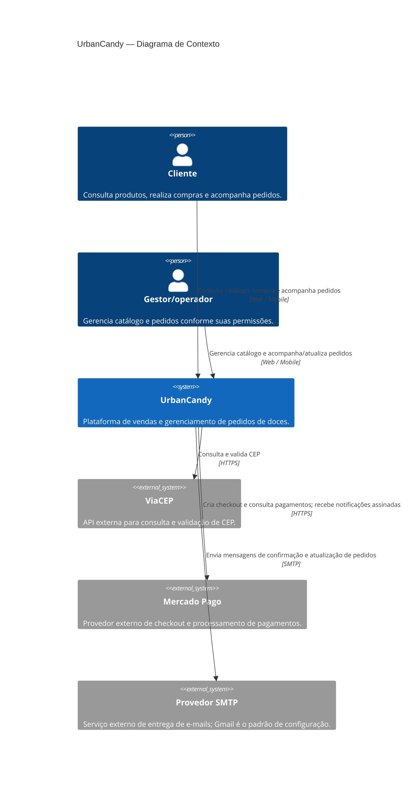

    # C4 — Diagrama de Contexto

O limite **UrbanCandy** representa a plataforma como um todo, incluindo suas aplicações Web e Mobile, o backend e o serviço interno de e-mail. Os componentes internos serão detalhados no Diagrama de Containers.

## Notas de leitura

- O gateway está identificado como **Mercado Pago**, que possui integração implementada; não é um componente planejado.
- O serviço de e-mail é interno à plataforma e não aparece como sistema externo neste nível. O provedor SMTP, usado por esse serviço, é externo.
- ViaCEP e o provedor SMTP são dependências externas. O diagrama mostra a relação da plataforma sem detalhar qual container inicia cada chamada.
- “Gestor/operador” representa as pessoas autorizadas a administrar catálogo e pedidos; as permissões concretas dependem da configuração do sistema.
- Este diagrama é o nível **Contexto** do C4. Ele não substitui o Diagrama de Containers.
