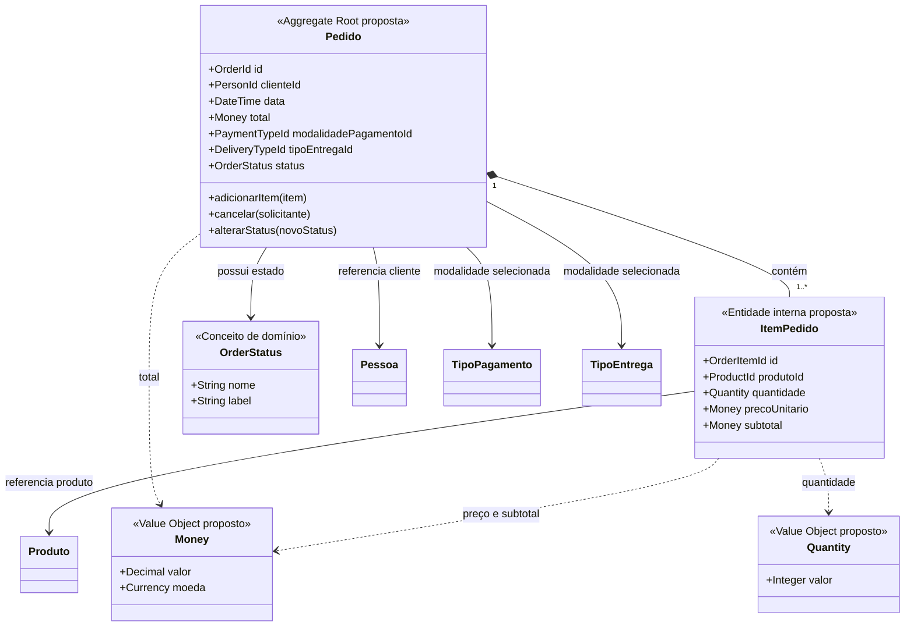

# Modelo de domínio — contexto Pedidos

## Responsabilidade e linguagem do domínio

O contexto proposto de Pedidos registra a intenção de compra, seus itens e o acompanhamento operacional até o encerramento.

- **Pedido:** compra registrada com pessoa, data, total, modalidade de pagamento, tipo de entrega e status.
- **Item do pedido:** produto referenciado, quantidade, preço unitário e subtotal.
- **Status:** estado consultável do pedido.
- **Cancelamento:** no comportamento atual, cancelamento solicitado pelo titular enquanto o pedido está “Recebido”.

O fluxo está implementado em [OrderService.ts](../../UrbanCandy_back/src/service/OrderService.ts), [OrderRepository.ts](../../UrbanCandy_back/src/repositories/OrderRepository.ts), [Orders.ts](../../UrbanCandy_back/src/models/Orders.ts), [OrderItem.ts](../../UrbanCandy_back/src/models/OrderItem.ts) e [OrderStatus.ts](../../UrbanCandy_back/src/models/OrderStatus.ts).

## Entidades persistidas observadas

| Model atual | Identidade/dados relevantes | Interpretação para o modelo |
|---|---|---|
| `Orders` | `id_orders`, `id_people`, `order_date`, `total`, `id_payment`, `id_type_delivery`, `status_id` | Candidato a entidade Pedido e raiz de agregado. |
| `OrderItem` | Identificador do item, pedido, produto, quantidade, preço unitário e subtotal | Candidato a entidade interna do agregado Pedido. |
| `OrderStatus` | ID, nome e label | Model/tabela de status consultável; sua transformação em conceito de domínio depende de encapsular regras e transições. |
| `Products` | ID, nome, descrição, preço, imagem, categoria, destaque e ingredientes | Entidade de Catálogo referenciada pelo item. |
| `TypeOfPayment` / `TypeOfDelivery` | ID e nome | Modalidades referenciadas pelo Pedido; não representam transação financeira nem logística externa. |
| `People` | ID, nome, CPF, telefone, usuário e endereço | Perfil associado ao Pedido; não é parte do agregado Pedido proposto. |

O inventário de models está em [UrbanCandy_back/src/models](../../UrbanCandy_back/src/models/); associações em [Associations.ts](../../UrbanCandy_back/src/models/Associations.ts).

## Value Objects candidatos

Estes são conceitos propostos, não classes implementadas. Atualmente o código usa primitivos/números e models Sequelize.

| Value Object candidato | Dados e regra a encapsular | Estado atual |
|---|---|---|
| `Money` | Valor decimal e moeda; operações monetárias consistentes para total, preço e subtotal. | Campos decimais; sem classe `Money`. A moeda não aparece modelada no pedido. |
| `Quantity` | Quantidade inteira positiva de itens. | Valor numérico primitivo. |
| `Email` | Endereço normalizado e validado. | String em `Users`; validação no serviço, sem tipo de domínio. |
| `OrderStatus` | Estado e, se especificado, validação de transições permitidas. | Tabela/model consultado por ID; transições completas não validadas no backend. |
| IDs tipados | `OrderId`, `PersonId`, `ProductId` etc., para evitar mistura acidental de identificadores. | Números primitivos. |

`Address` existe como model com ID e associação. Só deve ser redesenhado como Value Object se as regras de domínio tratarem o endereço como valor sem identidade própria; o esquema atual não resolve essa decisão.

## Agregado proposto

**Pedido** é a raiz do agregado. **Itens do pedido** são entidades internas, criadas junto com o pedido. Pessoa, produto, modalidade de pagamento e tipo de entrega são referências externas por identificador, não partes do agregado.

A composição e os Value Objects são decisões de modelagem futura. O repositório cria pedido e itens dentro de uma transação, mas isso, isoladamente, não significa que uma raiz de agregado DDD já esteja implementada.

## Regras implementadas e lacunas

| Regra | Evidência/estado |
|---|---|
| Checkout requer perfil, itens, total positivo e IDs positivos de modalidade de pagamento e entrega. | Implementado por `validateCheckoutData` em `OrderService`. |
| Pedido começa com status ID `1`, identificado no comentário do serviço como “Recebido”. | Implementado no checkout; o ID fixo é um acoplamento a substituir numa evolução. |
| Pedido e itens são salvos numa transação; falha causa rollback. | Implementado em `OrderRepository.createFullOrder`. |
| Cliente só cancela o próprio pedido no status ID `1`, e o sistema grava ID `5`. | Implementado em `OrderService.cancelOrder`. |
| Listagem operacional e mudança de status exigem permissões nas rotas selecionadas. | Implementado em `Private.ts`. |
| Backend recalcula o total e valida o preço vigente do Catálogo. | Não confirmado: o checkout recebe total e dados dos itens do cliente; o repositório usa os valores enviados. |
| Backend valida toda a máquina de estados. | Não confirmado: serviço aceita um ID de status; a interface escolhe o status seguinte. |
| Pagamento online é confirmado pelo provedor antes de registrar o pedido como aprovado. | Implementado via Mercado Pago: tentativa persistida, webhook assinado/consulta de status e criação transacional do pedido aprovado. |

Estas lacunas podem ser requisitos para evolução, mas não devem ser descritas como regras atuais.
